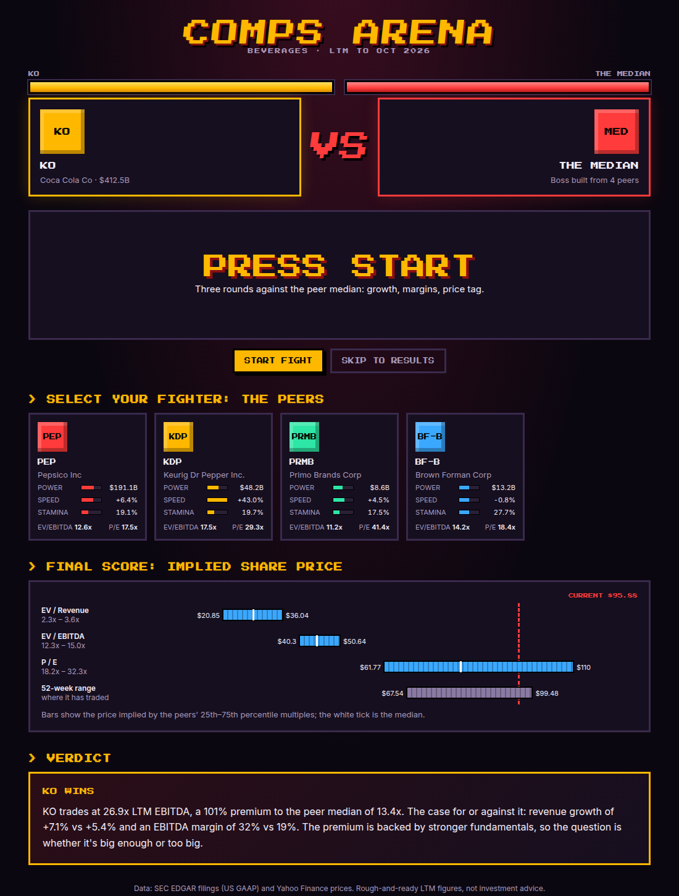
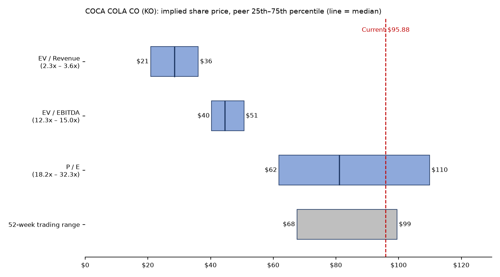

# Comps Arena

Trading comparables for any US-listed non-financial company, built straight from SEC filings. Give it a ticker and it:

1. picks a peer set (same SIC industry code, ranked by closeness in revenue), or uses the peers you choose;
2. calculates LTM revenue, EBITDA and net income, net debt, enterprise value, growth, margins, EV/Revenue, EV/EBITDA and P/E;
3. values the target off the peers' 25th–75th percentile multiples;
4. writes a **bank-style Excel workbook** (live formulas, blue inputs / black formulas, football field chart) and an **arena page** where the target fights the peer median over three rounds: growth, margins and price tag.



## Example: Coca-Cola vs beverages

```
$ comps KO

  Ticker  Mkt cap $bn  Growth  Margin  EV/Rev  EV/EBITDA     P/E
▶ KO            412.5      7%     32%    8.6x      26.9x   28.2x
  ------------------------------------------------------------
  PEP           191.1      6%     19%    2.4x      12.6x   17.5x
  KDP            48.2     43%     20%    3.5x      17.5x   29.3x
  PRMB            8.6      4%     17%    2.0x      11.2x   41.4x
  BF-B           13.2     -1%     28%    3.9x      14.2x   18.4x
  ------------------------------------------------------------
  Median                   5%     19%    2.9x      13.4x   23.8x
```

Coke trades at roughly twice the peer median EV/EBITDA. Faster growth and a much higher margin explain part of the premium, but valuing Coke on peer multiples gives about $45 a share against a $96 price. The rest is what the market pays for the brand, the pricing power and the low-capital franchise model that the peers don't share.



## How the numbers are built

| Item | Method |
|---|---|
| Financials | SEC EDGAR XBRL company facts (US GAAP filers only) |
| LTM | last fiscal year + current year-to-date − prior year-to-date, from 10-K and 10-Q filings |
| EBITDA | operating income + D&A from the cash flow statement; if a company has no operating income line, EBIT is rebuilt as pre-tax income + net interest |
| Net debt | long-term debt (incl. current portion) + short-term borrowings − cash and short-term investments; leases excluded |
| EV | market cap + net debt + minority interest |
| Shares | cover-page count, checked against the diluted weighted average so multi-class companies (Nike, Alphabet) aren't undercounted |
| Prices | Yahoo Finance, with the 52-week range |
| Peers | listed companies with the same 4-digit SIC code, closest in revenue; widened to neighbouring codes, then related industries, when the industry is thin |

Every figure that is estimated or adjusted is flagged on the workbook's *Notes* sheet.

## Known rough edges

- **No adjusted EBITDA.** One-offs and stock-based compensation aren't stripped out, so EBITDA is reported, not "adjusted".
- **SIC codes are blunt.** Nike's own code (rubber & plastics footwear) holds only Deckers, Crocs and On. When an industry is that thin, the tool widens to neighbouring codes, then to a short list of industries the SIC system splits apart (footwear and apparel, beverages, software, pharma, retail). Exact-industry peers always come first. Override with `--peers`, or drop a misfit with `--exclude`.
- **Financials are excluded** (SIC 6000–6799). Banks, insurers and REITs are valued on P/B and P/E, not EV/EBITDA.
- **IFRS filers** (most foreign companies filing 20-Fs) drop out of the peer set.
- **Captive finance arms** (Ford Credit, GM Financial) report debt under custom tags, so those companies' EV is understated.

## Usage

```bash
python -m venv .venv && .venv/bin/pip install -e .
mkdir -p ~/.config/comps-arena
echo "Comps Arena you@example.com" > ~/.config/comps-arena/user_agent   # the SEC requires a contact email

comps KO                                   # automatic peers
comps NKE --peers DECK,CROX,UAA,LULU       # your own peers
comps NKE --exclude PVH                    # automatic peers, minus one you disagree with
comps NVDA --n 8 --no-open                 # 8 peers, don't open the arena page
```

The arena page opens when the run finishes. Output goes to the project's `out/<TICKER>/`: `comps.xlsx`, `football_field.png` and `arena.html`. Responses are cached in `~/.cache/comps-arena`, and SEC requests are throttled to stay well inside its fair-access limits.

Tests: `.venv/bin/pip install -e .[test] && .venv/bin/pytest`
